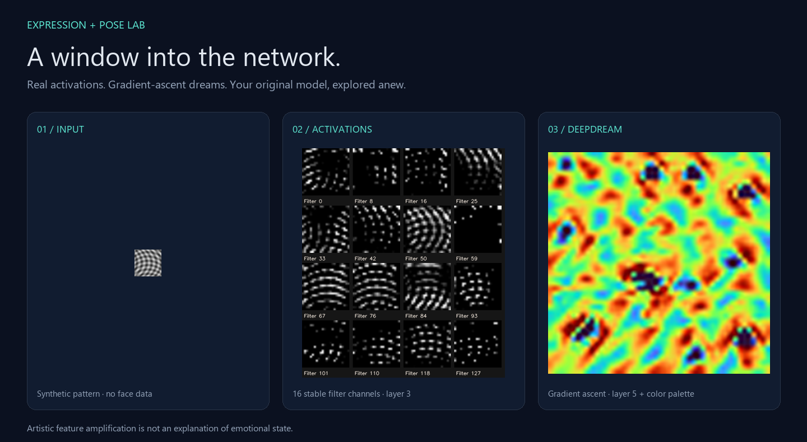

# Expression Lab

**Live expressions, body pose, and a window into the neural network.**



## Use the desktop app

Open **Expression Lab.exe** from the portable Windows folder. Keep `_internal` beside the executable. Python and a terminal are not needed for the packaged app. For a source checkout, run `python desktop.py` in the configured environment.

1. Choose **Camera**, **Screen**, or **Open image**.
2. Turn on **Expression predictions** or **Body pose** when you want those overlays.
3. Choose **Live view**, **Filter response**, **Dream**, **Feature maps**, or **Explain prediction** under Explore the model.
4. **Save face crops** saves detected faces. **Save neural artwork** exports the visualization. Nothing is recorded automatically.

The default view gives the input the available space. The neural panel appears only when you choose a visualization. Training is a separate developer tool, not an app button. **Import model** accepts a compatible `.keras` checkpoint and its matching `.json` metadata. **Model results** opens the evaluation report attached to the loaded model, verified against the checkpoint hash; it never asks you to browse for an arbitrary report.

### Understand what you see

| View or control | Meaning |
| --- | --- |
| Live view | Your input with optional expression and pose overlays. |
| Filter response | Inspect one filter on the original face. Left: exact 48×48 grayscale classifier input, enlarged, with the structural support box of a strongest unit. Right: a coarse response overlay. Yellow is higher and purple is lower within this image; colors are not confidence or semantic labels. No face means no map. |
| Feature maps | Responses from 16 filters. Brighter means stronger response **within that tile**. Each tile has its own scale; these are not class probabilities or an explanation of a prediction. |
| Dream | Multiscale gradient ascent through the loaded expression model’s convolutional features. The same weights operate on a larger image; classification still uses 48×48 faces. |
| Dream target | **One filter** uses the exact Layer and Filter ID you choose. Numbering matches Explore filters: layers start at 1, filters at 0. **Mixed features** restores the broader effect. |
| Develop this frame | Default Dream behavior. Holds one frame while 362 updates build large structures, then finer detail. Click again to start a new dream from the current input. |
| Follow live input | Faster, lighter effect that follows changing camera or screen content. It trades accumulated transformation for motion. |
| Dream area | Whole frame (default) or Face only. Face only uses the largest detected face, falling back to the whole frame when none is found. |
| Expand artwork | Gives the artwork the full available viewport instead of showing it beside the live input. Screen input plus Whole frame processes your screen scene. |
| Dream intensity | How far pixels change during each update. More is not more accurate. |
| Keep image structure | On by default. Smooths the update direction and limits luminance changes to 0.14 around the source at each scale and in the final preview. This source-image constraint preserves context; it does not add learned features. Turn it off for the previous unrestricted effect. |
| Pattern depth, in View settings | Applies to Mixed features + Follow live input: Fine detail / Shapes / Abstract select early / middle / late layers. Mixed features + Develop combines the three deepest layers. One filter always uses your exact selection. |
| Dream processing, in View settings | Quick / Balanced / Detailed perform 1 / 3 / 6 pixel-update steps per refresh. More steps take more time; they **do not retrain the model**. |
| Preserve input colors | Your model changes luminance; original chroma is preserved. The classifier still sees grayscale. |
| Explain prediction | Grad-CAM for the largest detected face using the loaded classifier. Choose a class; warm areas show relative positive support, not certainty. |
| Dream resolution, in View settings | Quick / Balanced / Detailed cap the longest edge at 256 / 384 / 512 pixels without stretching. CPU is capped at 256. |

To follow a filter you found in the explorer, choose **Dream → One filter → Layer 4 → Filter 35**, then **Develop this frame**. This is the initial selection for the bundled recovered model. **Follow live input** applies the same selected target to changing camera/screen content. Changing the filter starts fresh; importing a different model resets to its first layer and filter because IDs do not carry the same meaning between models.

For understanding what a filter responds to, start with **Filter response**, using the same layer/filter selectors. It performs a forward pass without changing input pixels. The yellow box marks the input region available to a strongest spatial unit, not a segmentation of an eye or mouth. The response overlay is interpolated from grid centers; broad receptive fields limit its precision. A uniform or all-zero response gets no invented highlight. Pair this view with the real dataset examples in **Explore filters** before assigning a semantic interpretation.

Dream now displays its actual starting image beside its result. Held-frame Dream keeps both views tied to the frozen input; live mode refreshes the pair together. Current-camera expression bars are hidden in these inspection views so they cannot be mistaken for scores on a frozen Dream. Capture continues until you stop it.

One filter maximizes that channel’s **mean response across spatial positions**. Other channels still participate in the forward network, but their responses are not added to the objective. The caption re-evaluates the actual displayed image and shows the selected channel’s before/after mean at that preview size. This is different from the explorer’s fixed-unit score. Jitter, resizing, color restoration, and pixel clipping mean the displayed score is not guaranteed to increase at every update; the caption reports the actual result.

The held-frame mode uses the same expression-model weights and a 48/96/192/output-size pyramid. It spends most updates at coarse scales before refining details. Mixed features balances the mean responses of three late layers; One filter targets only the chosen channel. Keep image structure constrains this optimization; unrestricted ascent can fill the image with repeated textures and erase its original structure. Results are model-dependent: face-like fragments are not guaranteed, and this remains artwork rather than a literal explanation of a prediction. Higher display resolution does not recover detail or learned RGB features missing from the 48×48 grayscale training data.

### Explore individual filters

**Explore filters** opens a local report for the loaded expression model, checking both the checkpoint hash and report hash. It shows six strongest dataset examples per filter, full-image context and structural support boxes, lower-response controls matched in global brightness/contrast, and single-unit Dreams from three seeds. Use the same layer/filter numbers in the live app’s One filter mode to explore that channel on your own input.

The recovered model analysis scans 896 convolution channels over 3,520 deduplicated FER2013 validation images. The new residual model analysis covers 1,248 channels on the same images. A Dream is marked as an increase only after re-evaluating the exact exported 8-bit pixels at the fixed target unit. Failed or negligible increases remain visible. Examples are ranked per image, with one peak region per distinct decoded image; near-duplicates may remain.

This establishes measured responses, not automatic semantic labels. Some filters respond to eyes and eyebrows, mouths, lighting or borders; dataset graphics and poor-quality inputs can also activate them. Late receptive fields often cover much of the face. A support box is not an attention map, and higher activation is not improved expression accuracy. Convolution outputs include any built-in activation; separate following normalization/activation layers are not included. Comparing raw values across models or filters is inappropriate.

Generate a report locally with the PyTorch environment:

```powershell
python filter_explorer.py models\expression-baseline.h5 data\fer2013.zip --output models\expression-baseline.filters.html
python filter_explorer.py experiments\my-run\best.keras data\fer2013.zip --output experiments\my-run\best.filters.html
```

Keep the `.filters.html` and `.filters.json` beside their matching model to attach the report. The adjacent `.filters.evidence.json` and `.filters.npz` retain numeric evidence and original/exported pixels for audit. Reports embed dataset images, are ignored by Git, and are not included in public source builds. The local installed app can carry separately generated reports; no automatic dataset download or camera recording is involved.

The procedure combines [dataset examples with feature optimization](https://distill.pub/2017/feature-visualization/) in a [filter exploration interface](https://distill.pub/2018/building-blocks/). Human annotations and controlled semantic interventions would be needed to substantiate a label such as “eye detector.”

### Expression model results

The app still defaults to the **recovered historical baseline**, not the missing final capstone model. The new residual candidate completed 50 epochs and scored **62.15% test accuracy and 58.36% macro F1**, improving over the compact candidate below on the same deduplicated FER2013 partition. It has 1,773,735 parameters versus the recovered baseline’s 2,787,015 (about 36% fewer). Its checkpoint was selected by validation loss. This is a comparison with the compact experiment, not proof of superiority to the lost FinalModel or a live-camera benchmark. A new compact candidate was trained from scratch, but its run stopped after 27 of 30 requested epochs. Evaluation of its saved best validation-loss checkpoint produced **59.1% test accuracy and 53.7% macro F1** on 3,572 deduplicated FER2013 test images. This is a development candidate, not a demonstrated improvement or a production-quality claim.

The historical baseline scored 92.8% on those images, but its original training-split provenance is unknown. That number may reflect prior exposure and **must not be presented as clean held-out accuracy**. A second spatial candidate collapsed during training and is not shipped as a recommended model. Live-camera accuracy remains unmeasured. See [dataset protocol](DATASET.md) and the checkpoint-specific reports for the full context.

### GPU acceleration

The Windows GPU path uses Keras with PyTorch CUDA. Expression inference and DeepDream gradients were verified on an RTX 5070 Laptop GPU (8 GB). Full-float32 predictions agreed with the TensorFlow CPU path within 0.000002 on a deterministic eight-input check. MediaPipe pose remains on CPU. GPU availability does not guarantee that every small visualization is faster; capture, face detection, rendering, and transfer overhead still matter.

For a fresh NVIDIA source environment, install `requirements-gpu.txt` instead of `requirements.txt`. The default backend chooses PyTorch when installed and otherwise TensorFlow. A CUDA-enabled PyTorch installation falls back to CPU when no compatible GPU is available. Set `KERAS_BACKEND=tensorflow` before launch to explicitly use the TensorFlow installation. The portable GPU bundle is large because it includes the CUDA runtime.

Dream and prediction explanations both use the loaded expression classifier. No unrelated ImageNet model drives the artwork. Dream clones the convolutional feature graph with exactly the same weights and flexible image dimensions, then uses coarse-to-fine ascent and jitter. Its source-color option restores chroma after luminance optimization. Applying 48×48-trained filters at larger sizes is an artistic extrapolation, not a higher-resolution accuracy claim. Truly learned color features would require labeled RGB training data.

Grad-CAM uses class gradients from the loaded model, without changing its weights or softmax. It is a coarse, relative localization of positive support for a class, not a causal proof or a measure of emotion. No face means no explanation heatmap. See the [Keras Grad-CAM reference](https://keras.io/examples/vision/grad_cam/).

Capture is capped at 30 FPS; artwork updates independently with bounded latest-frame queues. Actual speed depends on settings and hardware. Static-image face detections are reused until inference settings change; pose loads only when enabled. CPU Dream resolution is capped at 256 pixels on the longest edge.

### Training and automatic analytics

Training remains separate from the everyday app:

```powershell
python train.py path\to\fer2013.zip --architecture residual --epochs 50 --output experiments\new-run
```

Each completed run automatically generates learning curves, a confusion matrix (rows=true, columns=predicted), per-class precision/recall/F1, calibration diagnostics, JSON metrics, and saved predictions in an offline HTML report. No manual plotting step is required. Import the resulting `best.keras` with `best.json` to use it in the app; its report is discovered automatically. Architectures include residual, compact, spatial, the recovered baseline, and a reconstruction of the original final architecture. They all train from scratch. The large original model needs a smaller batch size, for example `--batch-size 16`.

The residual candidate uses four skip-connected convolution blocks (32/64/128/192 channels), a spatial dense head, dropout, AdamW, gradient clipping, and square-root class weights capped at 3. Its default learning rate is 0.0003. These are training hypotheses, not an accuracy guarantee. Checkpoints are selected by validation loss, and both the best and latest checkpoints are preserved. Class weighting can be changed with `--weighting none|sqrt|balanced`; record these choices when comparing runs.

---

A modern continuation of [Amir Edris's 2020 facial-expression capstone](https://github.com/AmirMEdris/Facial-Expression-Recognition).

This continuation combines the recovered expression baseline with MediaPipe body-pose landmarks. It runs locally on images, videos, camera frames, or screen capture. The original capstone repository is preserved.

## Quick start (Windows / Python 3.13)

```powershell
python -m venv .venv
.\.venv\Scripts\python.exe -m pip install -r requirements.txt
.\.venv\Scripts\python.exe download_models.py
.\.venv\Scripts\python.exe app.py --image path\to\photo.jpg --output results\photo.png
```

On macOS/Linux, use `.venv/bin/python` instead. Those platforms have not yet been verified for this project.

`requirements-lock.txt` records the earlier TensorFlow CPU environment. `requirements-gpu-lock.txt` records the desktop GPU development environment. CUDA wheels use the PyTorch index specified in `requirements-gpu.txt`.

```powershell
# Body pose only (does not load the expression model)
.\.venv\Scripts\python.exe app.py --image photo.jpg --pose-only

# Process a video and save an annotated MP4 + per-frame JSONL
.\.venv\Scripts\python.exe app.py --video input.mp4 --output results\video.mp4

# Open camera 0; Q or Escape closes it
.\.venv\Scripts\python.exe app.py --camera 0

# Run fast tests
.\.venv\Scripts\python.exe -m pip install -r requirements-dev.txt
.\.venv\Scripts\python.exe -m pytest
```

Camera/screen capture is never started by importing modules or installing the project. Images and videos are processed on the local machine. Downloads happen only when you run the model downloader or install packages. Video files are saved without audio. Explicit live recordings (`--output`) use a fixed 960x720 canvas at nominal 30 FPS and are not guaranteed to preserve wall-clock timing.

### Camera startup on Windows

After setup, double-click `launch_camera.cmd` to start camera 0 with the restored original controls. Nothing is saved automatically; Space explicitly saves detected face crops. Model loading can take 20–40 seconds. Click the main live window before pressing keys; Q or Escape closes it.

Camera capture tries DirectShow, Media Foundation, and automatic selection, requiring an actual frame before accepting a backend. If all fail, close other camera apps and try a normal desktop launch. A restricted execution environment may be unable to access a camera that works in Windows Camera. For another device, run `python app.py --camera 1` with the project environment activated.

### Original live controls

| Key | Action |
| --- | --- |
| A | Switch camera / screen; release the camera while viewing the screen |
| P | Toggle expression predictions |
| E | Toggle pose estimation |
| I | Show/hide instructions |
| F | Show/hide FPS and face count |
| Space | Save detected face crops in `results/captures` and open crop previews |
| Esc / Q | Exit and release capture resources |

Like the original notebook, normal live startup shows face boxes, instructions, and FPS with predictions and pose OFF. The improved pose coverage check still applies when E is enabled. Pose tracking resets when sources change. Failed switches retain the working source and show an error in the panel. Face crops now persist as PNG files instead of only being appended to the notebook's in-memory list. Use `--capture-dir` to choose a destination.

Start directly with the primary screen using `python app.py --screen`. Screen mode captures the full primary display rather than the old notebook's fixed `[900:, :1000]` slice. For a crop, use `--screen-region LEFT TOP WIDTH HEIGHT`, for example `python app.py --screen --screen-region 0 900 1000 600`. Keep the preview outside that region to avoid recursive screen capture. Large frames are reduced to 1280 pixels wide for processing; JSON face boxes refer to that processed frame. Live recording output is opt-in with `--output results/live.mp4`.

## What changed

- Replaced the missing `tf_pose` dependency with MediaPipe Pose Landmarker (lite).
- Preserved the original baseline architecture and grayscale 48×48 /255 preprocessing.
- Added standalone commands, pinned direct dependencies, verified model downloads, and tests.
- Batched expression inference across detected faces.
- Added an `uncertain` display label below a configurable model-score threshold (default 0.6).
- Kept raw class probabilities and pose visibility/presence in machine-readable output.
- Added resource cleanup and actionable input/model errors.

## Pose display and model comparison

The default display now withholds a skeleton unless all 12 major joints (shoulders, elbows, wrists, hips, knees, ankles) are inside the image and meet the visibility/presence threshold. This deliberately favors full-body input. Cropped or occluded people may be omitted even when some joints are accurate.

This is a **coverage check, not proof of correct alignment**. Wrong but confident skeletons can still pass. Raw landmarks remain in JSON under `poses`; `pose_quality` explains which estimates were withheld. The image footer reports withheld estimates. Use `--show-partial-poses` only to inspect raw, potentially wrong estimates.

```powershell
# Download the optional stronger models
.\.venv\Scripts\python.exe download_models.py --pose-model all
.\.venv\Scripts\python.exe app.py --image photo.jpg --pose-only --pose-model full
.\.venv\Scripts\python.exe app.py --video input.mp4 --pose-only --pose-model heavy --output results\heavy.mp4
```

`--landmark-threshold` adjusts the coverage threshold (default 0.5). Lite remains the default: full and heavy did not fix the crowded group-photo failure. All three performed better on an isolated person in the inspected samples. See `POSE_COMPARISON.md` for evidence and limitations.

## Model provenance and limits

Expression weights come from `model_filter.h5` in original commit `514316f2e5dce38a0e8ab35b50807f44fc57a2a4`. This is an early baseline, **not the missing FinalModel**. The original README credits the baseline architecture to Ashadullah Shawon. Its descriptive evaluation is subject to the unknown training-exposure caveat above.

Pose weights are the version-1 MediaPipe Pose Landmarker lite bundle, downloaded from Google's model hosting. See [Google's task documentation](https://ai.google.dev/edge/mediapipe/solutions/vision/pose_landmarker). Models are downloaded separately and retain their respective terms; this repository does not claim ownership of third-party models or imagery.

Expression labels describe model classifications of visible faces, not a person's internal emotional state. Scores are uncalibrated model probabilities. Pose and expression detections are independent: this version does not match faces to bodies, assign stable person IDs, or infer emotions from posture. The Haar face detector remains sensitive to lighting and head angle. Landmarks may be inaccurate for occluded people; only sufficiently visible/present points are drawn.

## Next milestones to build together

1. **External evaluation:** test on a separate, consented camera dataset and audit near-duplicates and identity overlap. FER2013 recovery, exact deduplication, and automatic reports are implemented.
2. **Better face detection:** measure failures on real camera footage, then compare a modern detector against the Haar baseline.
3. **Video behavior:** benchmark CPU latency/FPS, add stable tracking and temporal smoothing, and test camera capture on the target device.
4. **Training:** compare controlled architecture/augmentation changes and retain experiment configurations, seeds, metrics, and checkpoints.
5. **RGB expressions:** obtain a suitable labeled color dataset, adapt preprocessing and metadata, then compare against the grayscale classifier on a controlled evaluation.

See `VALIDATION.md` for the exact checks performed on the first milestone.
